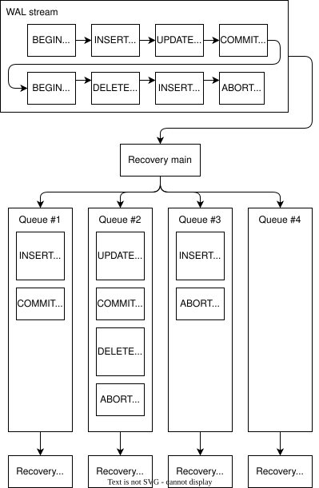
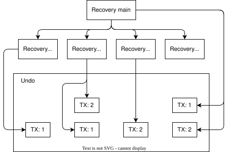
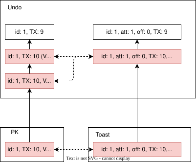
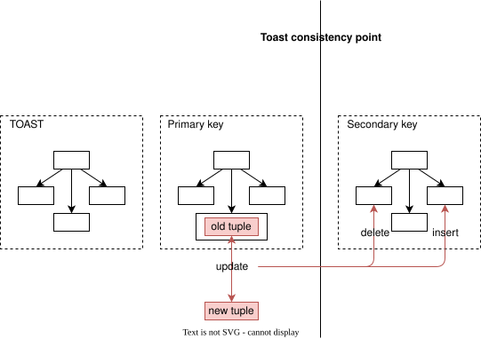

# Recovery & replication

OrioleDB leverages a distributed recovery mechanism, assigning each worker process its own set of primary key values to manage, facilitating scalable and efficient recovery and replication by splitting large transactions across multiple workers.

## Splitting work between multiple processes

OrioleDB implements multiprocess recovery and replication (technically, the replication in PostgreSQL is network-based recovery allowing concurrent read-only queries). The main recovery process reads the WAL stream and distributes the messages to recovery workers via queues.

Unlike other solutions, we do not distribute work between workers transaction-wise. Instead, each worker is responsible for his own set of keys (values of the primary key for each table). Therefore, the large transaction will be split into chunks for each worker. The essential advantage of this approach is the ability to scale the recovery and replication independently of the degree of transaction parallelism.

The picture below illustrates the recovery scheme involving the main recovery process and four recovery workers. The DMLs in the example are related to some single table, in which the primary key is the `id` column of integer type. The WAL stream contains transaction 1 comprising insert with `id = 1` and update with `id = 2`, transaction 2 comprising delete with `id = 2` and insert with `id = 3`. The main recovery process distributes these operations to the queues based on the hash of the `id` column (`id = 1` to queue 1, `id = 2` to queue 2, `id = 3` to queue 3).



Note that the main process does not distribute the transaction begin message because it does not know which workers will be involved in the transaction. Instead, it attaches the transaction id to the row modification messages. Also, note that OrioleDB transactions are not necessarily continuous chunks in WAL. They could be interleaved.

Main recovery process tracks which worker participates in which transaction. Once the transaction is committed or aborted in the WAL stream, the main process spreads this message to the participating workers.

Recovery workers are not synchronized on each transaction finish. So, worker #2 can process the `delete` message before worker #1 completes the `commit` message. It is possible because each worker has his own notion of finished transactions.

Recovery processes store the recovery transaction statuses in `recovery_xid_state_hash`. When transaction status needs to be clarified, the recovery process first checks `recovery_xid_state_hash` and only then the shared memory. The main recovery process updates transaction status in the shared memory only when all the worker processes have already processed the transaction finish message. Consequently, once the transaction status is updated in shared memory, the worker process can remove its entry from the hash.

Given that transaction is effectively split between the main process and multiple workers during recovery, the corresponding undo log is also split. The picture below illustrates this. The transaction may have the undo chain in the main process. That chain reflects transaction undo records that existed during checkpointing as well as undo of actions replayed by the main recovery process (such as DDL). Simultaneously, the transaction may have one or more undo chains in the recovery workers.



## Primary keys, TOAST, and secondary indexes

Recovery must bring all the table trees into a consistent state: primary key, TOAST, and secondary indexes. Primary key and TOAST are the primary information, while secondary indexes could be derived from them. That is why the OrioleDB WAL logs only changes in primary keys and TOAST trees.

The key of OrioleDB TOAST tree contains:

1.  Value of primary key,
2.  Attribute number for TOASTed value,
3.  Offset within the TOASTED value.

Therefore the single value is represented by one or more leaf tuples in TOAST trees with different offsets (starting from zero).

There could be multiple versions of the same tuple in the same transaction. Correspondingly there could be multiple versions of the TOASTed values (if they got updated). Therefore, we need to correctly match the version of a primary key tuple to that of a TOAST tuple. We handle this by attaching the version number to the tuple, as depicted below.



The version number is transaction-wise. Thus, in each new transaction, the version number starts from zero. Zero version number is the default. If the tuple does not contain the version number, then the version is zero. When the primary key tuple belonging to the in-progress transaction gets updated within the same transaction, its version increases. The TOASTed fields get updated, and TOAST tuples get the same version as the new primary key tuple. Therefore when we need to find the TOAST tuple corresponding to the given primary key tuple, we should find the tuple with the greatest version less than or equal to the primary key tuple's version.

OrioleDB needs to recover secondary indexes from the TOAST trees and primary key trees. Secondary indexes might be built on the TOASTed values, which complicates the thing.

Therefore, OrioleDB writes checkpoints in the following order:

1.  TOAST trees,
2.  Primary key trees,
3.  Secondary index trees.

Also, we are writing to the WAL TOAST tuples first and then primary key tuples.

## Logical decoding

PostgreSQL's logical decoding reads the WAL and hands the changes of each transaction to an output plugin, grouped by transaction id and in commit order. The changes of OrioleDB tables are decoded by OrioleDB itself: `orioledb_decode()` in `src/recovery/logical.c` parses the row-level WAL containers and queues their changes in PostgreSQL's reorder buffer, the same structure that holds the changes of heap tables.

### Logical transaction ids

A transaction on OrioleDB tables does not take a PostgreSQL transaction id (heap xid) unless it also writes a heap table, a sequence or the system catalog. The reorder buffer groups changes by a 32-bit xid, so the decoder needs one for every transaction and subtransaction. OrioleDB assigns a *logical xid* for that: a 32-bit number taken from a shared bitmap (`orioledb.logical_xid_buffers`) and never handed to PostgreSQL's transaction machinery. CLOG and the process array know nothing about it. The decoder marks such a transaction as synthetic in the reorder buffer (`RBTXN_DISTR_SYNTHETIC`, a flag added by OrioleDB's PostgreSQL patches), which keeps the reorder buffer from looking the xid up in CLOG and from streaming the transaction before its commit: streaming needs to check that the transaction is still running, and a logical xid cannot answer that. A transaction that exceeds `logical_decoding_work_mem` under a logical xid is spilled to disk and sent at commit.

A WAL container opens with an `XID` record that names the OrioleDB transaction, its logical xid and its heap xid, if it had one when the container was opened. Every record of the container belongs to the logical xid named by the last `XID` or `SAVEPOINT` record before it.

### Mixed transactions and the switch record

A transaction that writes both OrioleDB and heap tables has a heap xid and a logical xid. Its heap part commits through the PostgreSQL commit record, and the OrioleDB part has to commit with it. The decoder learns about the pair from a `SWITCH_LOGICAL_XID` record, which makes the logical xid a subtransaction of the heap xid in the reorder buffer. From then on the heap xid's commit commits the OrioleDB changes with it, its abort drops them, and the reorder buffer checks the liveness of the heap xid for the OrioleDB changes it streams.

### Streaming in-progress transactions

A big transaction on OrioleDB tables alone has no heap xid and so could never be streamed. Once it has written more OrioleDB WAL than `orioledb.logical_heap_xid_threshold`, it takes a heap xid like a mixed transaction, and writes the switch record at once:

```
container 1:  XID(oxid, lxid=X, heap=0)  INSERT  INSERT ...
container 2:  XID(oxid, lxid=X, heap=0)  INSERT  SWITCH(heap=H, lxid=X)  INSERT ...
                                                 ^ the threshold is reached: H is
                                                   assigned, X becomes H's child
container 3:  XID(oxid, lxid=X, heap=H)  INSERT ...
```

When the switch arrives, the reorder buffer moves the changes queued under the logical xid, spilled ones included, under the heap xid and streams the transaction as a whole from then on. The switch is written as soon as the heap xid exists, whoever assigned it: the threshold, a `nextval()`, a catalog write.

After a crash, recovery emits a rollback for the heap xid and the logical xid of every transaction left open, so the decoder drops them and the replication slot moves past the crash point.

When the checkpointing of the primary key trees is finished, we mark the current WAL position of the "toast consistency point". See the picture below.



We only apply WAL records to TOAST and primary key trees during recovery before the toast consistency point. We cannot "lose" any secondary index changes in that period because secondary index trees were checkpointed later. Thus, secondary indexes already contain all the changes made before the toast consistency point.

After the toast consistency point, we start to apply changes to the secondary indexes. Since TOAST WAL records are going first, we can fetch all the TOASTed values we need (if any) and apply the changes to the secondary indexes while applying the primary key WAL record.
